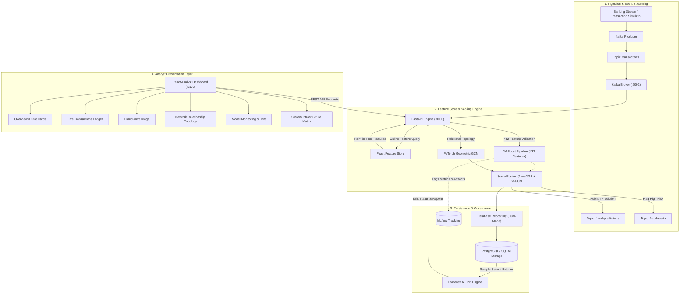

# Real-Time Financial Fraud Detection Platform

[](https://fastapi.tiangolo.com)
[](https://www.python.org)
[](https://xgboost.ai)
[](https://pyg.org)
[](https://feast.dev)
[](https://kafka.apache.org)
[](https://mlflow.org)
[](https://evidentlyai.com)
[](https://react.dev)
[](https://tailwindcss.com)

A portfolio-grade, production-ready **Real-Time Financial Fraud Detection Platform** built on the authentic **IEEE-CIS Fraud Detection dataset** (~590,540 transaction records and ~144,233 identity records). The platform features real-time 432-feature machine learning inference with **XGBoost**, relational anomaly analysis with **PyTorch Geometric (GCN)**, event-driven streaming with **Apache Kafka**, point-in-time feature serving with **Feast**, model drift monitoring with **Evidently AI**, experiment tracking via **MLflow**, persistent storage with **PostgreSQL / SQLite Dual-Mode**, and a dark-navy **React Analyst Dashboard**.

---

## 1. System Architecture



---

## 2. Machine Learning & Model Performance

### Model Pipeline Overview
* **Primary Classifier:** XGBoost (Extreme Gradient Boosting) within a Scikit-Learn `Pipeline`.
* **Preprocessing:** `ColumnTransformer` with `SimpleImputer` (median strategy for numericals, most-frequent strategy for categoricals) and `OneHotEncoder(handle_unknown='ignore')`.
* **Decision Threshold:** Configurable cutoff at `0.5000` calibrated for optimal recall on rare-event fraud distribution.
* **Input Feature Contract:** Strict 432-feature tabular schema matching the combined IEEE-CIS Transaction and Identity dataset.

### Validation Benchmark Metrics
| Metric | Measured Score | Evaluation Notes |
|---|---|---|
| **ROC-AUC** | **0.9086** | Area under the Receiver Operating Characteristic curve on chronological split |
| **PR-AUC** | **0.5189** | Precision-Recall AUC (critical for heavily imbalanced fraud data) |
| **Fraud Recall** | **73.0%** | Successfully flags ~73% of fraudulent events |
| **Fraud Precision** | **22.0%** | Measured at natural 3.5% dataset fraud prevalence rate |
| **Inference Latency** | **~1.2 ms** | End-to-end model evaluation per transaction event |

---

## 3. Technology Stack & Component Mapping

| Category | Technology | Version | Purpose in Platform |
|---|---|---|---|
| **Core Language** | Python | 3.11+ / 3.12 / 3.13 | Primary backend runtime |
| **Primary Classifier** | XGBoost & Scikit-Learn | 1.7+ / 1.4+ | 432-feature fraud scoring pipeline (`fraud_detection_xgboost.pkl`) |
| **Graph Relational GNN**| PyTorch & PyTorch Geometric | 2.6+ / 2.6+ | GCN relationship proxy clustering via shared `card1` attribute |
| **Event Streaming** | Apache Kafka / Confluent-Kafka | 3.5+ / 2.6+ | Real-time event publisher, transaction consumer & alert queue |
| **Feature Store** | Feast | 0.67.0 | Point-in-time correct historical feature generation and low-latency serving |
| **Experiment Tracking** | MLflow | 2.19+ | Parameter logging, validation metrics and model artifact registry |
| **Drift Monitoring** | Evidently AI | 0.7.23 | Kolmogorov-Smirnov distribution test and continuous drift HTML reporting |
| **Backend REST API** | FastAPI & Uvicorn | 0.115+ / 0.32+ | High-throughput asynchronous prediction and telemetry server |
| **Database** | PostgreSQL & SQLite | 15+ / 3.40+ | Dual-mode transaction ledger, alert queues and analyst review logs |
| **Frontend UI** | React, Vite, Tailwind CSS | 18.3 / 5.4 / 3.4 | Dark-navy analyst dashboard, SVG graph visualizer & live triage workspace |

---

## 4. End-to-End Execution Guide

### Prerequisites
* Python 3.11, 3.12, or 3.13 installed
* Node.js 18+ and npm installed
* Optional: Docker & Docker Compose (for PostgreSQL & Kafka containers)

### Step 1: Clone Repository and Setup Virtual Environment
```bash
git clone https://github.com/kalamsha335/Real-Time-Fraud-Detection.git
cd Real-Time-Fraud-Detection

# Create virtual environment
python -m venv .venv

# Activate on Windows (PowerShell):
.venv\Scripts\Activate.ps1
# Activate on Linux / macOS:
source .venv/bin/activate

# Install Python dependencies
pip install -r requirements.txt
```

### Step 2: Initialize Database
```bash
python database/init_db.py
```
*Note: The platform features a **Dual-Mode database engine**. If a PostgreSQL server is running (defined in `.env`), it connects directly. If PostgreSQL is offline, it automatically falls back to local SQLite at `database/fraud_detection.db` with zero configuration needed.*

### Step 3: Launch FastAPI Backend Server
```bash
uvicorn api.main:app --host 127.0.0.1 --port 8000 --reload
```
API Documentation and interactive Swagger UI will be available at:
👉 **http://127.0.0.1:8000/docs**

### Step 4: Launch React Analyst Dashboard
In a separate terminal:
```bash
cd frontend
npm install
npm run dev
```
Open your browser to:
👉 **http://localhost:5173**

### Step 5: Run the Transaction Simulator
In another terminal, publish synthetic transactions through the pipeline:
```bash
# Ingest 25 authentic IEEE-CIS sample records via HTTP at 5 events/sec:
python kafka/simulator.py --events 25 --rate 5.0 --url http://127.0.0.1:8000/predict
```
Alternatively, open the dashboard in your browser and click **⚡ Quick Inject** or **Simulate Stream** in the top navigation bar.

---

## 5. API Reference Summary

| Method | Endpoint | Description |
|---|---|---|
| `GET` | `/` | API status, version, and active model readiness check |
| `GET` | `/health` | Health diagnostics (model loaded, DB connection, active alerts) |
| `POST` | `/predict` | Evaluates 432-feature payload; returns fraud probability, risk level & classification |
| `POST` | `/simulator/inject` | Generates scenario-profiled events (`fraud`, `suspicious`, `legitimate`, `random`) |
| `GET` | `/transactions` | Paginated chronological ledger with risk and prediction filters |
| `GET` | `/transactions/{id}` | Full detail view including complete feature vector and audit logs |
| `GET` | `/alerts` | Alert triage queue for transactions flagged with `HIGH` or `MEDIUM` risk |
| `PATCH` | `/alerts/{id}/review` | Updates review status (`PENDING`, `INVESTIGATING`, `CONFIRMED_FRAUD`, `FALSE_POSITIVE`) |
| `GET` | `/metrics` | System statistics (total volume, detection rate, risk distributions, latency) |
| `GET` | `/model/info` | Production model metadata, threshold (0.50), and feature names list |
| `GET` | `/graph/analysis` | PyTorch Geometric proxy network topology, node degrees & fusion scoring |
| `GET` | `/monitoring/drift` | Evidently AI Kolmogorov-Smirnov drift test results and feature shift metrics |
| `POST` | `/monitoring/drift/run`| Forces recalculation of feature drift against baseline reference set |
| `GET` | `/monitoring/report` | Interactive Evidently AI HTML monitoring dashboard |

---

## 6. PyTorch Geometric Graph Analysis & Dataset Disclaimer

> [!IMPORTANT]
> **Research Disclaimer & IEEE-CIS Dataset Limitations:**  
> The IEEE-CIS Fraud Detection dataset does not provide verified customer identities or explicit syndicate labels. All graph relationships in this module use `card1` as an **anonymized relationship proxy**. High graph connectivity indicates shared attribute patterns, *not proven criminal syndicates*. The PyTorch Geometric GCN model serves as a complementary graph analysis module alongside XGBoost.

### Score Fusion Formula
To blend tabular XGBoost probability with relational GCN neighborhood scoring, the platform implements a configurable fusion equation:
$$\text{Final Risk Score} = (1 - w) \cdot P_{\text{XGB}} + w \cdot S_{\text{GCN}}$$
Where:
* $P_{\text{XGB}} \in [0, 1]$: Fraud probability from the primary XGBoost pipeline.
* $S_{\text{GCN}} \in [0, 1]$: Relational anomaly score from the PyTorch Geometric GCN.
* $w \in [0.0, 0.5]$: Fusion weight adjustable via the dashboard slider (defaults to $0.15$).

---

## 7. Model Monitoring: Drift vs. Degradation

The platform clearly distinguishes between **Feature Drift $P(X)$** and **Model Performance Degradation $P(Y|X)$**:

* **Feature Distribution Drift $P(X)$:** Monitored in **real time** using Evidently AI's two-sample Kolmogorov-Smirnov test on numerical features (e.g. `TransactionAmt`, prediction probabilities) against a 500-record reference baseline. Alerts engineering to shifting consumer behavior before accuracy suffers.
* **Model Performance Degradation $P(Y|X)$:** In financial fraud prevention, true accuracy degradation cannot be measured in real time. **Confirmed ground-truth labels require a 30 to 90 day lag** due to the bank dispute and chargeback cycle.

---

## 8. Automated Test Suite

The platform includes a comprehensive automated test suite with **50 unit and integration tests**:

```bash
pytest -v
```

```text
============================== test session starts ==============================
tests/test_api_phase1.py ...........                                     [ 22%]
tests/test_api_phase2.py ......                                          [ 34%]
tests/test_database_phase3.py ......                                     [ 46%]
tests/test_kafka_phase4.py .......                                       [ 60%]
tests/test_feast_phase5.py .....                                         [ 70%]
tests/test_graph_phase6.py .....                                         [ 80%]
tests/test_monitoring_phase7.py .....                                    [ 90%]
tests/test_e2e_platform.py .....                                         [100%]
============================== 50 passed in 27.54s ==============================
```

---

## 9. License

This project is open-source and available under the [MIT License](LICENSE).
